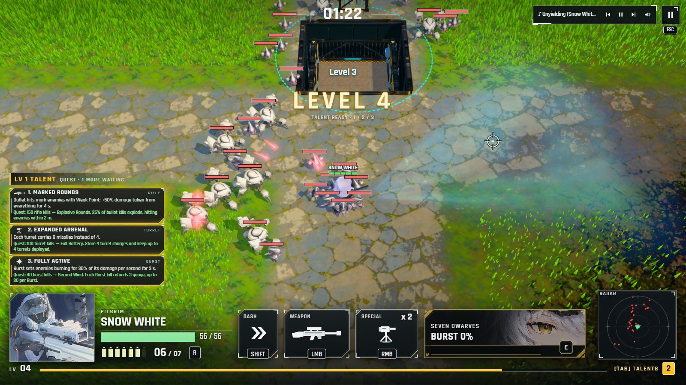
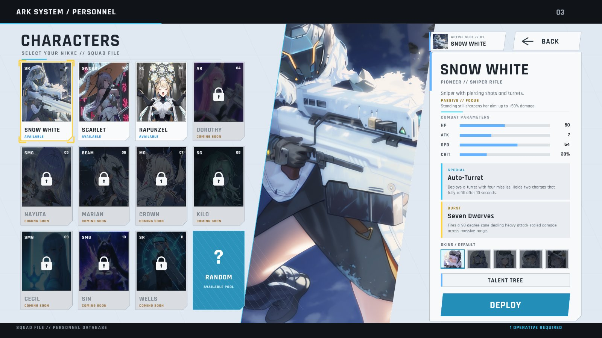
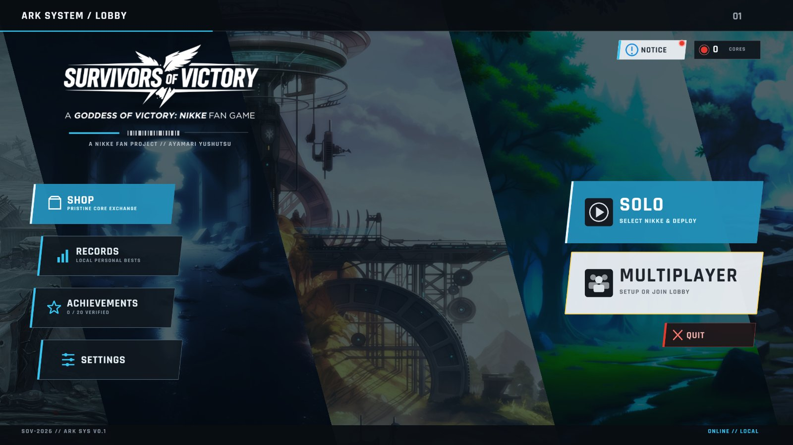
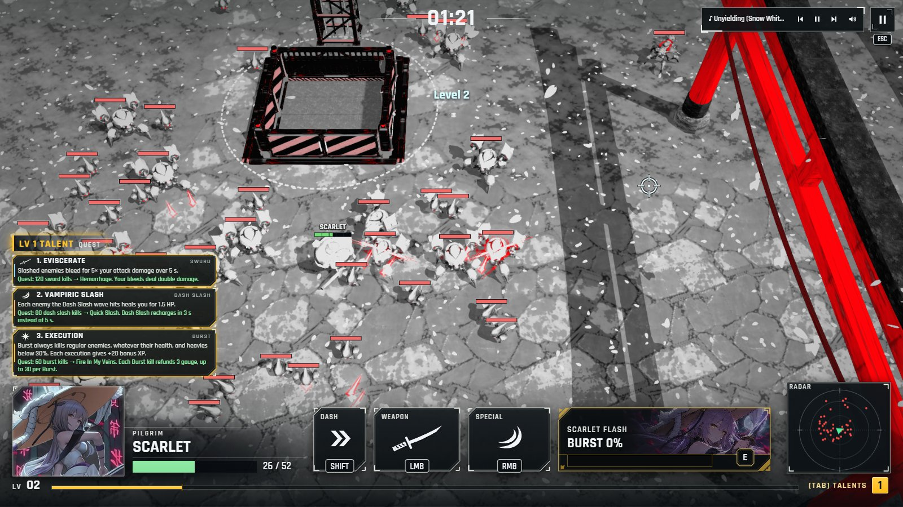
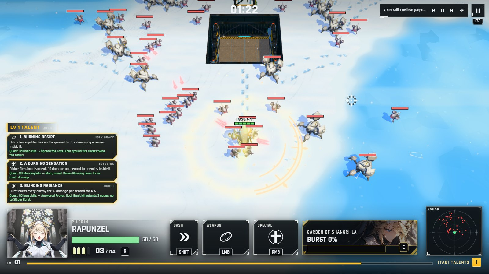
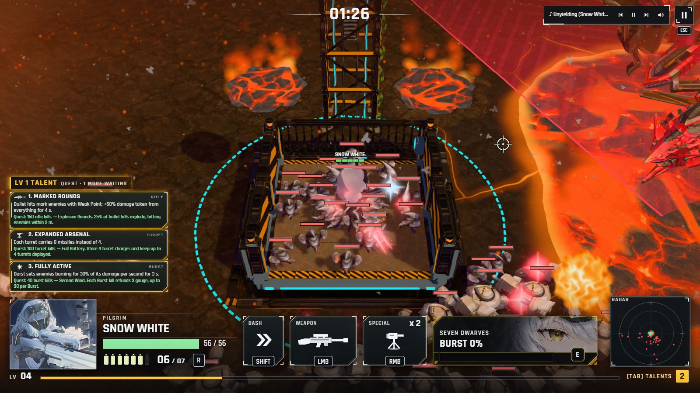
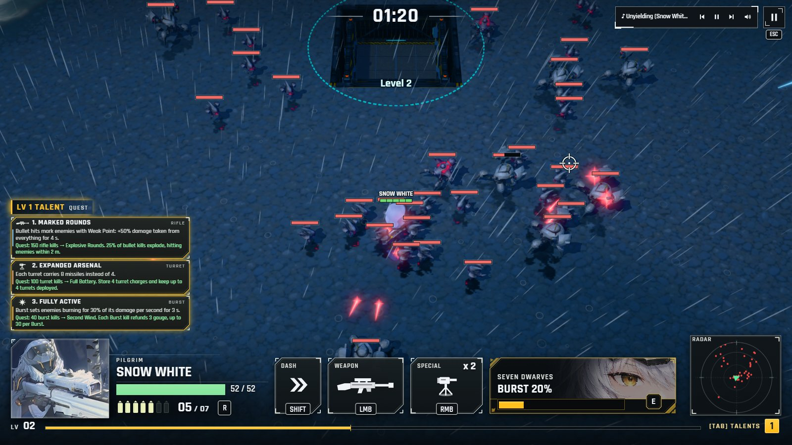
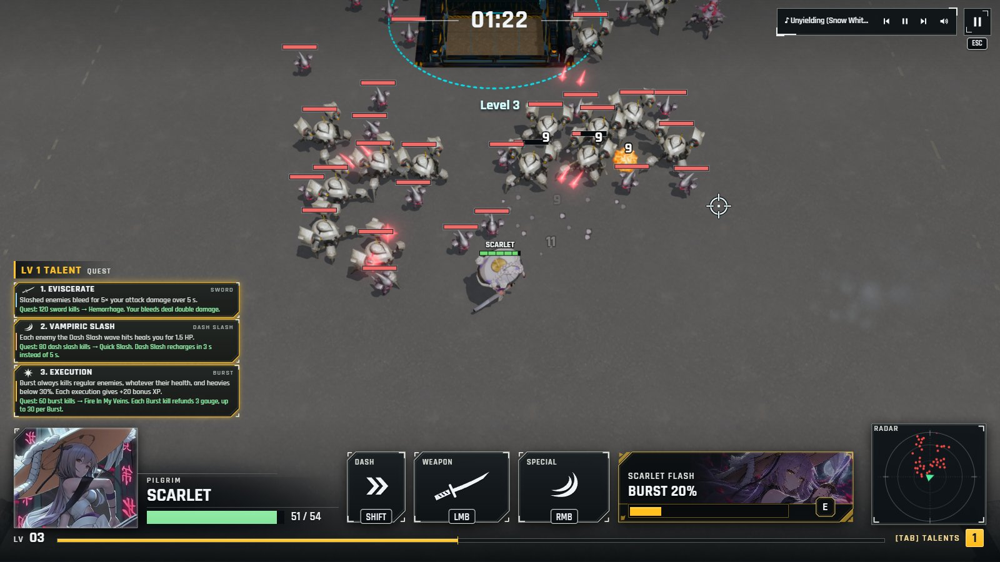

<div align="center">

# SURVIVORS OF VICTORY 3D

**A 3D horde-survival fan game set in the world of *Goddess of Victory: NIKKE*.**

Pick a Nikke, ride the lift down to the surface and hold out against an ever-growing Rapture horde.
Level up, choose talents, build Burst gauge, and survive long enough to face the boss.

[**⬇ Download for Windows (v0.1)**](https://github.com/exporterrormusic/survivors-of-victory-3d/releases/latest) · Closed alpha



</div>

---

## Gallery

<table>
<tr>
<td width="50%"><br><b>Character Select</b> · each Nikke has her own weapon, Special, Burst, passive and skins.</td>
<td width="50%"><br><b>The Ark lobby</b> · solo or multiplayer, shop, records and achievements.</td>
</tr>
<tr>
<td><br><b>Snow White · Seven Dwarves</b> · a 90° cone of heavy rifle fire across a massive range.</td>
<td><br><b>Scarlet · Scarlet Flash</b> · time stops and the world drains to grey while she cuts through the horde.</td>
</tr>
<tr>
<td><br><b>Rapunzel · Garden of Shangri-La</b> · golden rings of light in the Frozen North.</td>
<td><br><b>Rapunzel · Divine Blessing</b> · a holy circle burning Raptures in the Ashen Caldera.</td>
</tr>
<tr>
<td><br><b>Nihilister</b> · a giant meteor cracks the Caldera open and she tears a burning path across the map.</td>
<td><br><b>Stormbringer</b> · fighting through rain and lightning at night.</td>
</tr>
<tr>
<td colspan="2" align="center"><br><b>Grey Ruins</b> · Scarlet's sword against a swarm.</td>
</tr>
</table>

---

## How it plays

- **Survive the round.** In **Wave** mode you hold out for 10 minutes, then defeat the boss Obelisk to earn a Rapture Core. **Endless** never stops.
- **Level up and choose talents.** Every level offers a talent from your Nikke's tree. Talents reset each round, so every run builds differently.
- **Fire your Burst.** Kills charge your Burst gauge; at 100% press **E** to unleash her signature attack.
- **Squad support.** Every 60 seconds the lift brings down a health crate and mass-produced Nikkes who fight beside you.
- **Unlock more Nikkes.** Spend Rapture Cores in the Shop. Snow White is free; Scarlet and Rapunzel cost 3 Cores each, with more on the way.
- **Play together.** Multiplayer co-op uses a room code: no accounts, no sign-up.

### Nikkes

| Nikke | Weapon | Status |
| --- | --- | --- |
| Snow White | Sniper rifle · Auto-Turret · Seven Dwarves | Playable |
| Scarlet | Sword · Dash Slash · Scarlet Flash | Unlock (3 Cores) |
| Rapunzel | Holy Grace halos · Divine Blessing · Garden of Shangri-La | Unlock (3 Cores) |
| Dorothy, Nayuta, Marian, Crown, Kilo, Cecil, Sin, Wells | | Coming soon |

### Maps

Ashen Caldera · Ark Outskirts · Sakura Grove · The Frozen North · Grey Ruins · Stormbringer · Haunted Pine Forest

Some maps hide secrets. Look around.

### Controls

| Action | Key |
| --- | --- |
| Move | WASD |
| Aim | Mouse (she always faces the cursor) |
| Fire | Left mouse |
| Special | Right mouse |
| Dash | Shift |
| Burst | E |
| Reload | R |
| Talents | Tab |
| Pause / menu | Space / Esc |

---

## Install

1. Download `SurvivorsOfVictory-Setup-0.1.0.exe` from the [latest release](https://github.com/exporterrormusic/survivors-of-victory-3d/releases/latest).
2. Run it. Windows SmartScreen may warn because the installer isn't code-signed: choose **More info → Run anyway**.
3. The game updates itself when a new release is published.

Your cores, unlocks, skins, records and settings are saved on your PC. **Settings → Data** exports a backup file.

This is a closed alpha. Please report bugs, and how rounds felt, in [Issues](https://github.com/exporterrormusic/survivors-of-victory-3d/issues), with the version shown in the bottom-left of the main menu.

---

## For developers

Built with [Babylon.js](https://www.babylonjs.com/) (3D game), [Phaser](https://phaser.io/) (menus), TypeScript and Vite, packaged for Windows with Electron.

```
npm install
npm run dev            # http://localhost:5173
npm run build          # web build into dist/
npm run desktop:dist   # Windows installer into release/
```

Jump straight into a round: `http://localhost:5173/?run=test-range&mission=survival_round&zone=volcano_day&character=snow-white`.
Design notes and plans live in [docs/](docs/).

---

<sub>Survivors of Victory 3D is an unofficial, non-commercial fan project. It is not affiliated with, endorsed by, or sponsored by SHIFT UP or any official partner. *Goddess of Victory: NIKKE* and all related characters and trademarks belong to their respective owners.</sub>
