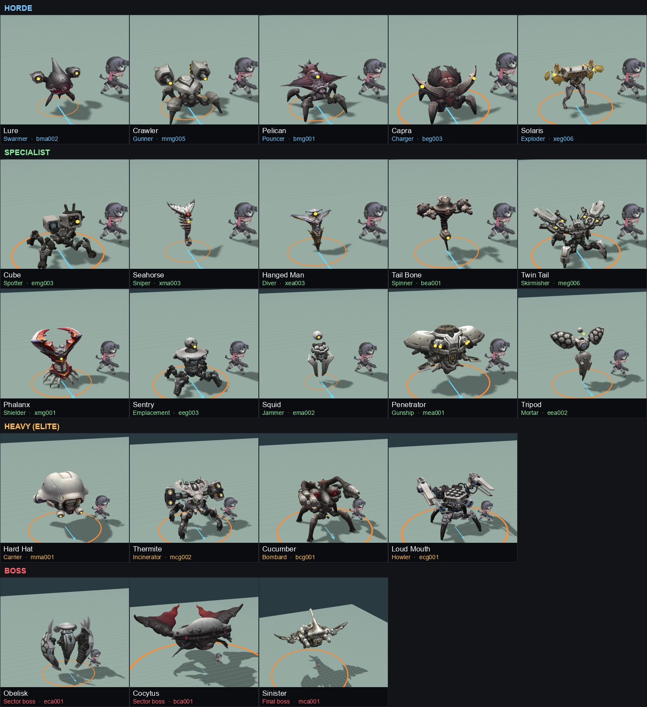

# Survivors of Victory 3D — game plan

2026-10-25 · Proposal for review · Replaces the Phaser draft's run structure and enemy list.
No code changes yet. All numbers are first-pass tuning targets.

**The world structure is still open.** This plan assumes separate sector maps chained into a
run; [WORLD_OPTIONS.md](WORLD_OPTIONS.md) compares nine alternatives (persistent regions, the
Descent, the Long Road, a war map, open world and more). Combat, enemies, bosses and the
search-and-lift loop carry over to any of them.

**Your build never resets.** Your NIKKE levels up for good and keeps her Weapon / Special /
Burst ranks between trips, using the current A02 ability-rank direction
([concepts](concepts/ability-progression-2026-10-25/README.md)). See §10 for what that changes.

**No NIPMH in the first version** (the user, 2026-10-25). It may come back later, so its code stays,
switched off in `src/features.ts`. The Shop sells character unlocks only. Lines below that mention
NIPMH or modules are marked as not in the first version; don't build them.



## The game in one paragraph

You are a NIKKE sent up from the Ark by lift onto the Rapture-held surface. Each **sortie**
drops you into a sector. You search the ruins for supplies and do one job, then make it back
to a lift: the one you came up on, or an old shaft you found and restored on the way. The
further you push from an exit, the longer and harder the way back. Everything you picked up
is at risk until the lift gates close.
Five sorties make an **operation**: two sectors, a sector boss, one more sector, then the final
boss and a last escape. The ride down between sorties is your maintenance stop.

## What changes from the Phaser draft

| Phaser draft | This plan |
| --- | --- |
| One map, a 10-minute timer, survive or reach a kill count | Sortie loop: search, do the job, get back to a lift, extract. You decide when to leave |
| 13 "trash tiers" that are the same shooter with more HP | 22 Raptures, each with one job and its own tell |
| Elites and bosses are big HP pools with beams | Heavies have 2–3 moves and a punish window. Bosses have phases and breakable parts |
| Kill-count objectives | Jobs that move you around the map (caches, nests, relays, survivors, a hunted elite) |
| Credits scale with par time | Credits come from what you find. The par-time bonus fights the "stay or leave" choice |
| Level and talents reset every run | Your NIKKE levels up for good. Power within a trip comes from what you find (field kits, §10) |

**Kept:** manual aim, kill XP awarded directly (no gems), SP per level spent on Weapon /
Special / Burst (now five ranks each, with a free capstone), the five-stage operation,
the difficulty slider and its scaling formula, a pulse every 30 seconds.

## Pillars

1. **Aim is the skill.** Weak points, lining enemies up for the piercing lance, and picking
   the right target first.
2. **Every attack is readable.** A tell comes before every hit. Nothing unavoidable.
3. **Greed is a choice.** Only time raises the threat. Searching costs time, and distance from
   an exit is your risk. You can always head for a lift.
4. **Playing is never punished.** Searching, fighting and clearing give power or lower the
   threat. Nothing you do makes the whole sector permanently harder.
5. **Every enemy changes what you do.** If two enemies ask for the same response, cut one.
6. **Builds come from authored ability ranks,** not random level-up cards. They're
   permanent, so leveling always counts.

---

## 1. Operation (one run)

```
ARK hub ─► Briefing: pick NIKKE, difficulty, starting zone
             │
  Sortie 1   Sector (early zone)        ─► lift ride: maintenance
  Sortie 2   Sector (early zone)        ─► lift ride
  Sortie 3   Sector boss (early zone)   ─► lift ride
  Sortie 4   Sector (late zone)         ─► lift ride
  Sortie 5   Final: Sinister, then escape
             │
           Debrief: banked salvage → Ark upgrades, records, achievements
```

- Level, SP and ability ranks are permanent (§10). Field kits found during an operation
  last until it ends.
- Time of day advances with the operation through the existing atmosphere system: Day for
  sorties 1–2, Dusk for 3–4, Night for the finale. Zones keep their weather defaults.
- Length: about 35–40 minutes (sortie timings and map sizes in §5).
- **Patrol** (short mode): sorties 1–3 only, about 20 minutes. It's also the first full loop to build.
- Later: route choice (concept F01) after each lift ride, choosing between two next sectors.

## 2. Sortie (one trip to the surface)

### Phases

| Phase | What happens |
| --- | --- |
| **Lift up** (0:00–0:10) | The platform rises through the shaft and the gates open. No spawns for 10 s. The radar shows the job marker, faint POI outlines within 40 m, and the lift you came up on |
| **Search** | Explore, work POIs, fight. Alert rises with time (below). Old lift towers stand out on the skyline; restoring one gives you a second exit |
| **Job** | The sector's objective. It pays out when you extract |
| **Push or head back** | Every minute out here costs Alert, and every metre from an exit is a metre you have to cover again. The radar shows the distance to the nearest working exit. At Alert 5 a Hunter is sent after you |
| **Get to a lift** | Fight your way to any working exit. The horde converges on you as you approach (a final pulse) |
| **Board** | Step onto the platform and the gates cycle shut over 8 s while you hold the platform. Leave it and the cycle pauses, but doesn't reset |
| **Extract** | Carried salvage is banked. Sector results, then the ride down (maintenance) |

**Leaving early** is allowed. You can extract before the job is done, but you forfeit the
job's reward and start the next sortie weaker. There's never a reason to skip the game.

**Dying** ends the operation. You keep all XP, levels and ranks, and everything banked on
earlier sorties. You lose what you're carrying on this sortie (credits, salvage,
field kits). Records and achievements still count.

### Exits

- **The arrival lift** stays at the top of its shaft as your known, guaranteed exit.
- **Dormant shafts** (3–5 per sector) are tall lift towers you can see from anywhere. Each one
  is a POI: restore it (8 s, standing in its ring) and it becomes a second working exit. They're
  usually near the far side of the map, out where the job tends to take you, so finding one is
  what lets you push deeper.
- The *Collapsed shaft* sector modifier sends the arrival lift back down. On those maps you have
  to find and restore an exit.

### Alert

The top-centre HUD currently says WAVE. That becomes **ALERT** with five pips.

| Alert | About when | Spawn budget | What it adds |
| --- | --- | --- | --- |
| 1 Quiet | arrival | 1.0× | horde only |
| 2 Aware | ~1:30 | 1.4× | specialists, exploders |
| 3 Hunting | ~3:00 | 1.9× | the zone's heavy (one at a time) |
| 4 Swarming | ~4:30 | 2.5× | bigger pulses, two specialist groups at once |
| 5 Hunted | ~6:00 | 3.0× | the Hunter is sent |

Alert rises by about one level every 90 s, **and only with time.** Nothing you do raises it.
What you do can lower the pressure instead: a Signal Scrambler drops Alert by one, killing the
Hunter drops it by one, and destroying a nest removes that spawn point. Searching costs time,
so the question is always "what's worth my next minute?", never "should I touch this?".
A good player finishes the job around Alert 3. A greedy one sees Alert 5.

Some POIs start a **local, opt-in fight** (a wreck's ambush, a supply drop the horde converges
on, guards at priority crates). Those fights are content: they're short, they stay where they
started, and they end.

### The Hunter

At Alert 5, the zone's heavy spawns off-screen as an Alpha (bigger, gold rim, extra HP) and
tracks you directly. It always knows where you are. It moves at 85% of your speed, faster when
far away, so you can kite it but not lose it. Killing it pays a Pristine Core and 200 credits,
and drops Alert to 4. The next Hunter comes 2:30 later and is stronger. Strong builds can keep
being greedy; weak builds should leave.

## 3. What you search for

**No new button.** Each POI has a cyan ring. Standing inside it works the POI, and you can
shoot while it fills. Stepping out pauses progress; it never resets.

| POI | Work | Gives | Catch |
| --- | --- | --- | --- |
| **Supply cache** | 1.5 s | 40–80 credits, 1–2 salvage; 30% chance of a field kit, 25% of a med kit (+20 HP) | — |
| ~~**Module case**~~ (not in the first version: NIPMH) | 3 s | a free NIPMH module into reserve, or credits if full | — |
| **Wreck** (transport, APC) | 6 s | 4–6 salvage, 150 credits, a field kit | starting it triggers a local ambush group |
| **Dormant lift shaft** | 8 s | a second working exit | usually far from the arrival lift |
| **Stranded Nikke** | reach her | she follows and fights. Each one who rides the lift out: +3 salvage, +XP | can be downed. Revive her by standing near for 3 s. Max 3 followers |
| **Data terminal** | 8 s | reveals every POI and dormant shaft on the radar, and the Hunter's position | — |
| **Signal scrambler** | 5 s | Alert −1 (once per sector) | guarded by a Phalanx pair |
| **Rapture nest** | destroy (400 HP) | XP burst, 3 salvage, and that spawn point is gone for the rest of the sortie | spawns 3 Lures every 4 s while you're within 30 m |
| **Med station** (rare) | 2 s | heals 50% max HP, once | — |
| **Supply drop** (event, Alert 3+) | 3 s | two field kits, credits | a flare marks the landing 20 s ahead, and the horde converges on it |
| **Fuel tank / barrel** (prop) | shoot it | 5 m explosion that hurts Raptures (and you) | — |

A standard sector has about 20–30 POIs across its sites: about 10 caches, 2–3 wrecks, 3–5
dormant shafts, 1–3 stranded Nikkes, 1–2 terminals, a scrambler, 2–4 nests, a med station,
plus the job's own markers. You'll reach about half of them.

## 4. Sector jobs

These reframe the existing `OperationObjectives` kinds so they send you around the map.

| Job | Existing kind | What you do |
| --- | --- | --- |
| **Salvage Run** | supply | Recover 3–4 marked priority crates (4 s each). Each one spawns a guard group |
| **Search & Rescue** | rescue | Find 2–3 pinned-down Nikke squads and clear their attackers. They follow you to the lift. Only squads still alive when you extract pay out |
| **Purge** | exterminate | Destroy 3–4 Rapture nests |
| **Hunt** | priority-target | Kill a marked heavy that roams the sector. It shows on the radar within 50 m; a terminal reveals it anywhere |
| **Restore Power** | (new, from M01 Reclamation) | Every lift in the sector is dark. At each of 2–3 relays, destroy the Rapture jammer, then restore the relay (6 s). Each restored relay turns into a cyan Ark turret for the rest of the sortie; the last one powers the lifts |
| **Hold** | survive | A Rapture-held Ark depot. An engineer strips it while you keep the horde off; progress ticks while you're within 18 m of her, which is wide enough to kite in (90–150 s). It pays a lot of salvage, but it's usually far from the arrival lift |

**Boss sortie** (sortie 3): a smaller arena map (~70 m) with a 60 s approach and a light horde.
Then the boss. When it dies, its chest drops and the arena's lift comes up on the far side. Get
there through the leftovers.

## 5. Maps and zones

### Size

Everything is measured in **seconds of travel**, not metres. Snow White runs at 6 m/s
unimpeded, and makes about 2.5–3.5 m/s of real progress while fighting a horde. At the
default camera zoom one screen shows about **19 m across at the hero and 18 m deep**, roughly
3 seconds of running. For comparison, the test range is 68 m across.

| Map | Size | Screens across | Straight run across | Used for |
| --- | --- | --- | --- | --- |
| Boss arena | 60–90 m | 3–5 | 10–15 s | sorties 3 and 5 |
| Standard sector | 160 × 160 m | about 8 | about 27 s | most jobs |
| Large sector | 200 × 200 m | about 10 | about 33 s | Search & Rescue, Salvage Run (jobs that need spread) |

A standard sector is about 7× the test range's area; a large one about 11×. Alert rises 15%
slower on large sectors, so a bigger map isn't simply a harder one.

**Why this big.** A bigger map doesn't make a sortie longer, because the Alert clock sets the
length. It means you see less of the map each time. You visit roughly the same number of
sites, but there are about twice as many to choose from, so you always have unseen ground and
a real choice of direction. An earlier draft had 110 m, where an efficient player saw most of
the map every time; that reads as an arena with things in it, not a surface to search. Site
spacing stays the same, so bigger means more sites, not more empty ground.

**Confirm with a graybox before building art.** Block out one sector at 160 m with coloured
site markers, play the loop with the horde at the real camera, then scale travel distances with
one factor until it feels right. That's how the MOBA battlegrounds got their size (the first
compact blockout was too small, and travel distances were scaled 1.8×).

### Layout: sites and routes

- **Built from sites, not scattered pickups.** A standard map has 12–16 sites: a wrecked
  convoy, a collapsed station, a nest garden, a lift tower. Each has 1–3 POIs, some cover and
  a fight. A typical sortie visits 6–9 of them.
- **Sites are 30–50 m apart** (5–8 s), so you're never more than about 8 seconds from the
  next thing to do.
- **Loops, not dead ends.** Routes run around blocks of ruins, with at least two ways between
  neighbouring sites. No dead end longer than one screen, except a small reward nook.
- **55–65% of the ground is walkable.** The rest is ruins that shape the routes.
- **Authored maps, shuffled contents.** Each zone has one hand-built map with 20–25 site
  slots. Each sortie fills 12–16 of them with random site types and loot, and picks the arrival
  lift from 2–3 edge positions. You learn the streets but can't memorize the best route.
- **The arrival lift sits near one edge,** with dormant shafts spread across the rest, so
  the map always has a far side worth getting to.
- **Cover:** tall ruins block shots both ways; low cover (sandbags, rubble) only blocks
  movement. Tall pieces fade out when they come between the camera and the hero.

### Short walks, worthwhile exploration

**Keeping walks from getting boring**
1. **Travel is fighting.** The director keeps a minimum horde within about 25 m of you, so
   moving is kiting, never empty walking. Areas whose nests you destroyed have a lower minimum.
2. **See where things are before you commit.** Landmarks show over the ruins: lift towers
   have beacons, wrecks have smoke columns, nests have a red haze, supply drops and pinned-down
   Nikke squads fire flares. The radar marks POI types within 40 m; a terminal reveals all.
   Exploring means choosing a direction, not wandering.
3. **The way back is a different trip.** Thanks to the loops you can return a different way.
   Your cleared route is safer (fewer spawns where you killed nests). Unexplored ground has
   loot and more risk.
4. **The world changes behind you.** By the time you head back, Alert is higher, nests you
   skipped have filled their area, supply drops have landed and the Hunter may be out. Going
   back is new fighting, not a replay.
5. **Exits shorten the trip home.** On a standard map the farthest point is about 150 m from
   the arrival lift: about 25 s unimpeded, about a minute fighting. There are 3–5 dormant
   shafts, placed so no point is more than about 60 m from one, so finding a shaft cuts the
   worst way home by more than half.
6. **Fix a long walk with layout first:** shrink the map, add a site or add a loop. Don't
   add movement tech (sprint, rails) unless that fails. Speed already comes from permanent
   upgrades.

**Keeping exploration worth it**
- **You can't see everything.** An efficient player reaches about half the sites before
  Alert 5. Exploring is choosing which half, not clearing a checklist.
- **What you find changes the run:** field kits that power you up for the trip, med kits, a
  closer exit, Nikkes who fight for you, a scrambler that buys time.
  Credits and salvage build toward gear and account upgrades.
- **The shuffle** keeps the next sortie on the same map a new decision.

**Making it feel like exploration** (size alone doesn't)
- **The radar charts as you go.** The map's layout stays blank until you've seen it, so you're
  mapping the sector yourself. A terminal fills in a large area at once.
- **Interiors.** Some sites are inside buildings. The roof and upper walls cut away when you
  step in, revealing a room you couldn't see from the street.
- **Edges that keep going.** Map borders are cliffs, collapsed highways, deep water or rubble
  fields, with a ruined skyline and distant Ark lift towers beyond. Never a visible wall.
- **Places with identities.** A crashed Ark transport, a flooded subway mouth, a frozen convoy.
  Every site looks like somewhere, so you remember the map.
- **Secrets.** Breakable walls and side nooks off the main loop, with a cache behind them.
- **Surface records.** Logs found in sites (what happened up here) collect in Records: a reason
  to look around that isn't power.

### How long

| Sortie | Target | Shape |
| --- | --- | --- |
| Sector | 5–8 min, typically about 6.5 | 0:10 arrival · job done around 3:30–5:00 (Alert 3–4) · optional greed · 0:30–1:30 back to an exit. Alert 5 and the Hunter at 6:00 are the soft limit |
| Boss | 5–6 min | 1:00 approach · 3–5 min fight · 0:30 to the lift |
| Final | about 8 min | 1:30 approach · about 5 min Sinister · 1:30 escape |
| Lift ride | player-paced, about 1 min | maintenance |

A full operation is about 35–40 minutes; Patrol about 20.

### Zones

| Zone | When | Look and layout | Signature enemies | Heavy / Hunter | Boss |
| --- | --- | --- | --- | --- | --- |
| **Ark Outskirts** | early | Sakura groves around collapsed lift towers. Open, long sight lines. Petals/clear | Cube, Phalanx, Seahorse | Hard Hat | Obelisk |
| **The Frozen North** | early | Snowfields, a frozen lake in the middle, pine edges. Snow. **Whiteout** pulses cut visibility to 25 m for 15 s; enemy tells still show through | Hanged Man, Tripod, Phalanx | Thermite | Cocytus |
| **Dead City** (new) | late | Ruined blocks, streets, overpasses; reuses the MOBA's overgrown industrial kit. Tight sight lines, so cover and LOS matter. Fuel trucks | Sentry, Twin Tail, Penetrator, Cube | Cucumber | — |
| **Stormbringer** | late | Night rainforest in a thunderstorm. **Lightning** strikes are telegraphed (yellow circle, 1.2 s) and hit anything, Raptures included | Tail Bone, Squid, Twin Tail, Seahorse | Loud Mouth | — |
| **The Hollow** | final | A crater around a fallen Ark lift column. Night, ash in the air | everything | — | Sinister |

You pick the starting zone at the briefing, which also picks the sortie 3 boss. Early zones
draw from the core horde plus their three signature specialists. Late zones draw from
everything, weighted toward their signatures. Each zone's heavy is also its Hunter.

**Sector modifiers** (later, shown on route choice): *Rich* (+50% salvage, Alert rises 25%
faster), *Infested* (+1 nest, +XP), *Blackout* (night, radar range halved), *Reinforced* (a
guaranteed heavy that drops a Pristine Core), *Collapsed shaft* (the arrival lift goes back
down; find and restore another exit).

---

## 6. Enemy rules

**Tell language.** The same signal means the same thing everywhere.

| Signal | Meaning |
| --- | --- |
| Red ground decal that fills up | Area damage lands when it's full (mortars, dives, slams) |
| Thin red line on you | An aimed shot is locking. It **stops tracking and turns white** 0.35 s before firing |
| Orange lane with chevrons | A charge, leap or strafing run will travel this path |
| Yellow flare on eyes or muzzles | About to fire projectiles |
| Purple | A status zone (slow, jam) |
| Cyan | Friendly: your turret, relays, the lift, POI rings |

- **Minimum tell times:** horde 0.35–0.5 s, specialist 0.8 s, heavy 1.0–1.4 s, boss 1.2–2 s.
- **Enemy projectiles** are slow (5–9 m/s), hot-coloured (red, orange, magenta) with a bright
  core, so they read against Snow White's cold blue and the weather. No hitscan without a laser tell.
- **Off-screen fairness:** off-screen enemies don't attack. Exceptions: a sniper line (the
  line itself crosses the screen) and heavies, which get an edge arrow.
- **Contact damage** is horde-only, with a 0.6 s cooldown per enemy.
- **Flyers** are hit by aiming at their spot on the ground. Their shadow ring marks it.
- **Statuses show as VFX, never text** (frost on the model for chill, a purple tint for jam).
  Overhead UI stays bars only. Heavies get a thicker armoured bar; only bosses get a name, in
  the top boss bar.
- **Size reads as threat.** Display targets relative to the hero: horde about 1×, specialists
  1.2–1.6×, heavies 2.5–3.5×, bosses 5× and up. Fodder gets scaled down, heavies stay big.
- **Caps** stop unfair stacks: Seahorse 3, Cube 2, Tripod 3, Sentry 2, Squid 2, Tail Bone 2,
  Penetrator 2, heavies 2 (outside boss fights), Hunter 1.
- **Dash needs i-frames** (first 0.25 s) once enemies can hurt you. It is the universal answer
  to telegraphed hits. That probably also means a cooldown or charges (see Decisions).

## 7. Enemy roster

HP and damage are base values (difficulty 1, sortie 1) before scaling. For reference, Snow
White's lance does 7 (10.5 on a crit) and pierces everything; she has 50 HP. Speed is in m/s;
she runs at 6. "Cost" is what the spawn director pays for one.

### Horde — the crowd

| Rapture | Role | HP | Speed | Hit | Cost | From |
| --- | --- | --- | --- | --- | --- | --- |
| Lure | Swarmer | 6 | 3.2 | 4 | 1 | sortie 1 |
| Crawler | Gunner | 12 | 2.6 | 2 × 4 | 2 | sortie 1 |
| Pelican | Pouncer | 10 | 3.6 | 8 | 2 | sortie 1 |
| Solaris | Exploder | 16 | 4.2 | 18 | 3 | sortie 1, Alert 2 |
| Capra | Charger | 30 | 2.8 (charge 12) | 14 | 4 | sortie 2 |

**Lure — Swarmer** · `bma002`
- *Does:* comes in flocks of 6–12 and runs straight at you. Most of the screen is Lures.
- *Attack:* within 1.2 m its eye pods flare (0.35 s), then it zaps for 4.
- *Answer:* anything. Flocks string out into lines, which is exactly what the lance wants.
- *Asset:* native walk. Ready.

**Crawler — Gunner** · `mmg005`
- *Does:* holds 8–12 m away and sidesteps about 2 m after every volley.
- *Attack:* both cannons glow yellow (0.6 s), then fire a pair of slow bolts (6 m/s, 4 each) every 3.5 s.
- *Answer:* keep strafing; the bolts are easy to walk around. Kill it when it stops to fire.
- *Asset:* native walk, two muzzles. Already used in the MOBA.

**Pelican — Pouncer** · `bmg001`
- *Does:* arrives in threes from the flanks.
- *Attack:* at 6 m it crouches and flares its spikes (0.5 s, orange lane), then leaps 6 m (14 m/s) for 8 and a small knockback. It's stuck for 0.8 s after landing.
- *Answer:* step off the lane, then shoot it while it's stuck.
- *Asset:* borrows Crawler's walk.

**Solaris — Exploder** · `xeg006`
- *Does:* sprints at you with its golden charge held overhead.
- *Attack:* within 3 m it plants itself and a red ring grows over 1.0 s to 4 m, then it explodes: 18 to you, 30 to any Rapture caught in it. If you kill it, it drops the charge, which goes off 0.6 s later (3 m).
- *Answer:* shoot it early. Even better, shoot it when it's inside a flock.
- *Asset:* walk from the Nikke Biped legs. Doesn't need a shot clip; the blast is VFX.

**Capra — Charger** · `beg003`
- *Does:* a tougher bruiser that shows up from sortie 2.
- *Attack:* at 7–15 m it lowers its pincers and paws the ground (0.9 s, an 18 m orange lane), then charges straight at 12 m/s: 14 damage and a big knockback. It tramples Raptures in its path (20 each). If it hits a wall it's stunned for 2.5 s and takes +50% damage.
- *Answer:* stand in front of cover and dodge late. Or bait the charge through the horde.
- *Asset:* Crawler walk with leg IK.

### Specialists — one per problem

| Rapture | Role | HP | Speed | Hit | Cost | Cap |
| --- | --- | --- | --- | --- | --- | --- |
| Cube | Spotter | 20 | 2.4 | 3 × 12 (strike) | 6 | 2 |
| Phalanx | Shielder | 60 + 80 shield | 1.8 | 10 | 6 | 3 |
| Seahorse | Sniper | 14 | 2.0 (hover) | 16 | 6 | 3 |
| Tripod | Mortar | 50 | 1.6 (hover) | 3 × 10 | 7 | 3 |
| Hanged Man | Diver | 18 | 5.0 (flying) | 14 | 5 | 4 |
| Twin Tail | Skirmisher | 40 | 4.2 | 3 × 4 fan / 10 beam | 6 | 4 |
| Sentry | Emplacement | 70 | 2.0 | 3 per bolt | 8 | 2 |
| Tail Bone | Spinner | 26 | 2.2 (hover) | 4 per orb | 6 | 2 |
| Squid | Jammer | 35 | 2.4 (hover) | pools and aura | 7 | 2 |
| Penetrator | Gunship | 55 | 12 on a run (flying) | 12 | 8 | 2 |

**Cube — Spotter** · `emg003`
- *Does:* holds 14–20 m away and wants line of sight to you.
- *Attack:* paints you with a thin red laser for 2.0 s, with a rising tone. If it keeps line of sight the whole time, it calls a strike: three red circles (2.5 m), one on you and two where you're heading, landing after 1.2 s for 12 each.
- *Answer:* it's fragile, so kill it on sight. Or break line of sight behind tall cover; that cancels the call.
- *Asset:* walk with leg IK. The camera head sells it.

**Phalanx — Shielder** · `xmg001`
- *Does:* glides slowly in front of groups (gun lines, mortars).
- *Attack:* its claws project a 120° frontal energy wall that **blocks all player projectiles, the piercing lance included**. Raptures behind it are covered. Every 4 s the claws rear back (0.6 s) and snap forward: a 3 m cone, 10 damage, knockback. The shield (80) comes back 5 s after it last took damage, taking 1.5 s to rise.
- *Answer:* flank it (it turns at only 50°/s). Use the turret's missiles, which arc over, or Burst.
- *Asset:* glides on idle.

**Seahorse — Sniper** · `xma003`
- *Does:* floats 20–28 m away, often near the edge of the screen.
- *Attack:* its red eye charges and a laser line tracks you for 1.5 s, then freezes and turns white (0.35 s). It fires a fast round (40 m/s) for 16 that pierces any Raptures in the way.
- *Answer:* sidestep once the line freezes, or break line of sight. Its rounds can kill its own side.
- *Asset:* hovers.

**Tripod — Mortar** · `eea002`
- *Does:* hangs back 16–24 m, often behind cover (it lobs, so cover doesn't stop it).
- *Attack:* every 4 s its three hex pods each launch a shell. Three red circles (2.5 m): one on you, two predicted along your movement. They land after 1.4 s for 10 each. The shells are visible in the air.
- *Answer:* change direction; running in a straight line is what the prediction punishes. Then go and kill it.
- *Asset:* hovers.

**Hanged Man — Diver** · `xea003`
- *Does:* flies 4 m up, over cover and the crowd, circling you at about 10 m.
- *Attack:* marks a red circle under you (2.5 m). It follows you for 0.6 s, locks, and fills over 0.4 s. Then it dives for 14 and knocks you up. It's stuck in the ground for 1.5 s afterwards and takes double damage.
- *Answer:* dash out once the circle locks, then punish it while it's stuck.
- *Asset:* floats. The blade shape reads well as a dive.

**Twin Tail — Skirmisher** · `meg006`
- *Does:* a fast spider that circles at 9–12 m.
- *Attack:* every 2.5 s each tail flashes and fires a 3-bolt fan (4 each). Every third volley, both tails charge for 1.0 s, showing two parallel yellow lines, then fire twin piercing beams 18 m long for 10.
- *Answer:* its circling path is predictable, so lead your shot. Stay out of the parallel lines.
- *Asset:* native walk, four muzzles. `shot2` (the beams) isn't baked by `src/crowd.ts` yet.

**Sentry — Emplacement** · `eeg003`
- *Does:* walks to a spot 10–18 m away with line of sight, then plants its legs and raises its dome (1.5 s).
- *Attack:* once deployed, it fires a stream of bolts (8 per second, 6 m/s, 3 each) while turning toward you at 60°/s. Every 4 s it stops for 1.2 s to cool, venting glow. If you stay out of sight for 5 s, it packs up and moves.
- *Answer:* circle it faster than it turns. Its back panel takes +50% while deployed.
- *Asset:* walk with leg IK.

**Tail Bone — Spinner** · `bea001`
- *Does:* floats in to 8–10 m and anchors itself.
- *Attack:* drops its spike and spins up (0.8 s glow), then spins for 3 s throwing a three-arm spiral of slow orbs (5 m/s, 4 each, 18 per second). It's dizzy for 1.5 s afterwards.
- *Answer:* kill it during spin-up, or keep your distance; the spiral's gaps widen as it spreads.
- *Asset:* hovers. The weighted head reads as a spinning top.

**Squid — Jammer** · `ema002`
- *Does:* hides 10–14 m back, behind the horde.
- *Attack:* lobs a purple glob (1.0 s arc, landing circle shown). It leaves a 4 m pool for 6 s that slows you by 35% and stops the Burst gauge filling while you stand in it. It also has an 8 m purple aura in which your Special recharges at half speed.
- *Answer:* kill it first. Its pools herd you, so watch your exits.
- *Asset:* hovers.

**Penetrator — Gunship** · `mea001`
- *Does:* flies 5 m up and makes strafing runs.
- *Attack:* picks a line through you and shows a long 2.5 m-wide orange lane (1.2 s), then flies down it at 12 m/s with all four cannons firing: 12 if you're in it, and Raptures in the lane take damage too. Then it banks and turns for 2 s, showing its broadside.
- *Answer:* step out of the lane, then shoot it while it turns.
- *Asset:* floats. Needs a banking tilt in code.

### Heavies — elites and mini-bosses

Heavies appear from Alert 3, as the Hunt target and as the Hunter. From Alert 4, one may be
guarding the exit you head for. Each has two or three moves and one punish window where it
takes double damage.

| Rapture | Role | HP | Speed | Biggest hit | Zone |
| --- | --- | --- | --- | --- | --- |
| Hard Hat | Carrier | 450 | 2.0 (hover) | 16 (ram) | Ark Outskirts |
| Thermite | Incinerator | 600 | 2.2 | 8 per 0.5 s (flame) | Frozen North |
| Cucumber | Bombard | 700 | 1.8 | 14 (carpet) | Dead City |
| Loud Mouth | Howler | 800 | 2.0 | 12 (ring) | Stormbringer |

**Hard Hat — Carrier** · `mma001`
- *Drop:* every 10 s it stops and its front hatch opens (1.0 s, eyes go red), releasing 6 Lures and 2 Pelicans. Below 50% HP it releases 2 Solaris instead of the Pelicans.
- *Ram:* if you're within 6 m, its dome tilts (0.8 s, orange lane) and it lurches 8 m for 16.
- *Punish:* the dome cuts damage by 60%, except while the hatch is open. Then it takes double.
- *Asset:* hovers, two eye muzzles for flashes.

**Thermite — Incinerator** · `mcg002`
- *Flame sweep:* its four lamp pods ignite (0.8 s), then it sprays a 60° cone 7 m long, sweeping through 90° over 2 s. 8 per 0.5 s inside.
- *Thermite charges:* lobs three charges in a line toward you (red circles). They leave burning ground for 6 s (4 per 0.5 s), which burns Raptures too and channels the horde.
- *Punish:* after three attacks it overheats: back panels open and it vents steam for 3 s, double damage and no attacks.
- *Asset:* walk with leg IK, four muzzles.

**Cucumber — Bombard** · `bcg001`
- *Missile salvo:* six pods fire six slow homing missiles (7 m/s, limited turning, 6 each). Missiles have 1 HP and can be shot down; one lance through the pack clears it.
- *Carpet:* a 4 × 20 m red strip toward you fills over 1.5 s, then a line of explosions (14).
- *Barrage* (below 50%): every 15 s, twelve circles land around you over 3 s.
- *Punish:* during the carpet's 1.5 s fill it doesn't move and its red eye pods take double.
- *Asset:* walk with leg IK, six muzzles.

**Loud Mouth — Howler** · `ecg001`
- *Shockwave:* its speaker grid glows with a low hum (1.0 s), then an expanding ring travels out to 18 m (10 m/s, 0.6 m tall): 12 and a slow. Dash through it or be outside it. Below 50% it sends three rings back to back.
- *Sonic cone:* 30°, 14 m, 1.2 s tell. 10 damage and a 6 m knockback that can push you into hazards.
- *Rally howl:* every 20 s, all Raptures within 20 m get +30% speed and attack rate for 8 s (their eyes glow red).
- *Punish:* for 2 s after a howl it stands still with the grid exposed, taking double.
- *Asset:* walk with leg IK. No muzzle sockets; give it one on the speaker grid.

### Alpha variants (later)

Any horde or specialist Rapture can spawn as an **Alpha**: 1.4× size, 6× HP, a gold rim, and
one affix: *Shielded* (a regenerating bubble), *Volatile* (explodes on death), *Swift* (+40%
speed), *Splitting* (splits into three small copies) or *Commanding* (allies nearby +20%
damage). One Alpha can lead each 30 s pulse and drops a cache. This stretches the 22 models
without new art.

---

## 8. Boss classes

| Class | Who | Where | UI | Rules |
| --- | --- | --- | --- | --- |
| **Heavy** (mini-boss) | Hard Hat, Thermite, Cucumber, Loud Mouth | Alert 3+, guarding exits at Alert 4+, Hunt job, Hunter | thick overhead bar, no name | 2–3 moves, one punish window, no phases |
| **Sector boss** | Obelisk, Cocytus | Sortie 3 | top boss bar with name and phase ticks | 3 phases, own arena, breakable parts, adds, enrage at 5:00 |
| **Final boss** | Sinister | Sortie 5 | boss bar plus a list of parts | multipart (concept M03 Breach Hunt), then the escape |

Bosses never one-shot you and have no fatal countdown like the Phaser N01's 174 s explosion.
Enrage raises attack speed and density instead. Adds keep coming at a reduced rate during the
fight, so XP and Burst keep flowing. Boss chest: a Pristine Core and salvage (a choice of one
NIPMH module from three is not in the first version). Target fight length: 3–5 minutes.

*Future:* the N01 Rapture Queen (the Phaser finale) as a hard-mode or secret final, once there's
a 3D model for her.

### Obelisk — sector boss, Ark Outskirts

A floating core between two hex-armoured shell halves. **3,500 HP.** Arena: the plaza around
Old Lift No. 4, ~60 m across, with four pillars for cover.

**Phase 1 — Bulwark (100–66%).** Shells closed; the core only takes damage while they're open.
- *Shell barrage:* the shells crack open (0.8 s) and the core fires three rings of slow orbs with gaps, then they close. The core is exposed for 2.5 s.
- *Monolith drop:* it rises, a 6 m red circle follows you then locks (1.4 s), and it slams down for 20, sending out a shockwave ring (dash through it).
- *Adds:* Phalanx gun lines (Phalanx plus Crawlers).

**Phase 2 — Unfold (66–33%).** The shells detach and orbit the core at 6 m as moving shields.
Time your shots through the gaps.
- *Twin beams:* two lines appear (1.2 s), then sustained beams rotate a full circle over 6 s. Stay ahead of them.
- *Boomerang:* a shell flies out along an orange lane (1.0 s tell) and comes back.
- *Breakable:* each shell has 700 HP. Breaking one removes its boomerang and leaves that side of the core open for good.
- *Adds:* Pelicans.

**Phase 3 — Overload (33–0%).** Surviving shells clamp back on and the core turns red.
- *Pylons:* four pylons rise around the arena and beam into the core, making it immune. Each has 150 HP (line two up for the lance). With all four down, the core is open for 8 s. They come back every 25 s.
- *Shell barrage* returns, faster.

### Cocytus — sector boss, The Frozen North

A flying whale-shaped Rapture with red fins, named after the frozen lake of hell. **4,500 HP.**
Arena: the frozen lake, ~80 m, open, ringed by pines.

New status, **Chill**: frost on the model, stacking. Three stacks freeze you for 1 s; it
decays one stack every 2 s.

**Phase 1 — Overflight (100–60%).**
- *Strafing pass:* its shadow and a frost lane appear 1.5 s ahead, then it crosses the arena, dropping frost bombs behind it (1.0 s circles, 12 plus Chill).
- *Icicle rain:* ten circles scattered across the arena.
- *Adds:* Hanged Men diving out of the snow.

**Phase 2 — Breach (60–25%).** It crashes through the ice and hunts from below.
- *Erupt:* water rings spread from a point under you (1.2 s), then it bursts up for 18 and a knock-up. It leaves a hole of open water you can't cross, so the arena slowly shrinks.
- *Freezing breath:* while surfaced (4 s), a 2 s cone sweep.
- *Breakable:* its red fins take double damage while it's surfaced. Each fin has 600 HP; breaking one slows its passes and removes the frost-bomb drops.

**Phase 3 — Whiteout (25–0%).** A blizzard. Visibility drops and Chill builds over time unless
you stand near one of three burning braziers. Its breath can put a brazier out. It dives at you
every 6 s.
- *Adds:* Squid.

### Sinister — final boss, The Hollow

A 17 m winged airship with a spire cannon on its back. It's too big to walk around, so it hovers
along the north edge of a ~90 m arena and drifts side to side. **Hull 6,000** plus four parts.
The hull takes 25% damage until two parts are destroyed.

| Part | HP | What it does | When destroyed |
| --- | --- | --- | --- |
| Wing battery ×2 | 900 each | homing missile swarms (shootable, like Cucumber's) | that side stops firing and the ship lists toward it |
| Hangar bay (belly) | 1,200 | opens every 20 s to drop 4 Hanged Men and Pelicans | no more drops |
| Spire cannon | 1,500, only exposed while charging | **main cannon:** spire glows for 2.0 s and a 4 m lane crosses the whole arena, then a 35-damage beam | no main cannon, but phase 2 starts immediately |

**Phase 1 — Standoff.** Batteries, hangar and an occasional main cannon. The arena has three
destructible cover blocks for hiding from the beam.

**Phase 2 — Descent** (two parts down or hull at 60%). It comes in low over the arena. The beam
now sweeps 60° across the arena. It drops anchor spikes that send out shockwave rings.

**Phase 3 — Crash** (hull at 25%). It slams into the crater, burning. The reactor is exposed
(triple damage) in 20 s windows between reactor surges (expanding rings). Final horde call.

**Escape.** When it dies the crater starts to collapse. The only working lift is the fallen Ark
column on the far side of the crater. Run for it through everything left in the zone, with
falling debris (red circles) behind you, then hold the platform while the gates cycle. Board
and the operation is complete.

---

## 9. Spawning and pacing

- **Director:** a threat budget per second (by sortie and Alert) buys groups from the zone's
  weighted table, within the caps. A **pulse** every 30 s spends a larger chunk at once.
- **Groups, not single units,** so the roles combine:

| Group | Contents |
| --- | --- |
| Swarm | 8–12 Lures |
| Gun line | 4 Crawlers behind a Phalanx |
| Pounce | 3 Pelicans from one flank |
| Demolition | 2 Solaris hidden in a Lure swarm |
| Fire base | Sentry + Cube |
| Artillery | 2 Tripods behind a Phalanx |
| Air raid | 3 Hanged Men + a Penetrator |
| Rally | Loud Mouth + Swarm + Gun line (the final pulse at an exit, late in a sortie) |

- **Where they come from:** emergence holes authored into each map (a ground-burst effect),
  with an off-screen ring as the fallback. Flyers come in from the sky at the map edge. Never
  within 14 m of the player, never on screen, never in front of the lift gates during arrival.
- **Below the hero:** the default camera shows 13.5 m above her on screen but only 4.6 m below,
  so a Lure coming from the bottom edge reaches her about 1.4 s after it appears. Either spawn
  fewer groups from the south, or shift the camera focus a little south. Playtest both.
- **How many alive at once (targets):** early 40–70, mid-sortie 100–180, the run to the exit
  at Alert 4–5 200–300.
  Needs a performance check. Far-away AI updates at a lower rate, and a spatial grid handles
  queries (the Phaser version has one to port).
- **Zone scaling, never level scaling.** Enemy HP ×1.0 / 1.3 / 1.6 / 2.0 / 2.4 and damage
  ×1.0 / 1.1 / 1.2 / 1.35 / 1.5 for early zone / early zone (second visit) / sector boss /
  late zone / final. Boss HP above is already at its own tier. Enemies never scale to your
  level, so going back over-leveled feels like the payoff it is. The difficulty slider's
  existing formula stacks on top.

## 10. Progression and economy

### Your NIKKE levels up for good

Level and ability ranks never reset: not between sorties, not between operations, not when you
die. This follows the A02 ability-rank roadmap
([concepts](concepts/ability-progression-2026-10-25/README.md)).

- Kill XP is awarded directly; each level gives 1 SP. SP buys Weapon, Special or Burst ranks
  (ranks 2–5 cost 1 / 2 / 3 / 4 SP; rank 5 also unlocks that ability's capstone for free). You can
  spend at any time, including mid-trip from the Tab screen, which pauses the game.
- Each NIKKE has her own level and ranks.
- **Free respec at the Ark,** so trying a different focus never costs progress.
- **New NIKKEs catch up.** NIKKE's Synchro Device raises other Nikkes to your top level. Same
  idea here: a newly unlocked NIKKE starts a few levels below your highest, so switching
  characters isn't a grind.

### Pacing

With A02's costs, a focused first capstone needs level 11, and all three need level 31. On the
current XP curve that's about **14,000 XP** and **124,000 XP**. At Phaser-like kill XP (6–12 per
horde kill, a few hundred per heavy), a sector yields roughly 5,000–7,000 XP. So level 11 would
take 2–3 sorties and level 31 about 20 sorties, around 2.5 hours. That's probably too fast once
the game is longer than that.

- **Target:** a first capstone around the first sector boss, all three around the final boss.
  Set kill XP (or stretch the curve) once the total content length is known.
- **Decide what levels past 31 do:** a hard cap, or small account-wide bonuses.

### Power within a trip

A permanent build removes the survivors genre's "start weak, end as a monster" curve inside
each trip, because you start every trip at full strength. These bring a climb back:

- **Field kits:** small boosts found in caches, wrecks and supply drops that last until you
  extract or die. Examples: *Extended Mag* (+2 rounds), *Hot Loads* (+10% damage), *Crit Chip*
  (+5% crit), *Quick Hands* (−15% reload), *Turret Parts* (+1 turret), *Burst Cell* (+15% Burst
  gain). Each stacks up to 3. They're fixed pickups, not random card choices. They're also the
  most direct reason to explore: every site you work makes you stronger right now.
- **Level-ups during the trip,** spent straight away.
- **Followers and turrets you earn:** rescued Nikkes, restored relays.
- **The Burst gauge,** as now.

### Enemies scale by zone, never by your level

Each zone shows a recommended level: early zones 1–12, the first sector boss around 10–12,
late zones about 13–25, the final about 28 and up. Coming back over-leveled makes a zone easy,
which is the reward for leveling. Alert provides the climb in danger within a trip. Higher
difficulty tiers stay available for challenge and pay more.

### What dying costs

| Kept | Lost |
| --- | --- |
| XP, levels, ranks | what you're carrying on this trip: credits, salvage, field kits |
| everything banked on earlier extractions | |

### Currencies

All of them are carried during a trip and banked when you extract.

- **Credits** come from caches, wrecks, job completion (the existing 300 base) and heavy or
  Hunter kills. They buy **repairs** (NIPMH modules are not in the first version).
- **Salvage** turns into **Core Dust**, which buys account-wide stat upgrades (the existing
  Attack / HP / Speed / Crit / XP list), shared by every NIKKE.
- **Pristine Cores** (rare: heavies 15%, Hunters and bosses always) unlock characters
  (Commander and Cecil are locked today) and higher difficulty tiers. The Shop sells only
  character unlocks in the first version.

**Not in the first version (2026-10-25):** **NIPMH as gear** (a later option): with a permanent build, modules fit best as gear you own. You
find them on the surface (module cases, supply drops, boss chests) or buy them with credits,
bank them by extracting, and equip them before going up, within the existing weighted capacity.

**HP between sorties** (if the sector-run structure stays): the lift ride heals 30% of max HP;
the rest costs credits (repairs) or comes from med kits. That connects greed and spending.

Records and achievements continue. New ones: extract with three Nikkes, kill a Hunter, finish
a sector at Alert 1, and so on.

## 11. HUD additions

All of these use the current flat HUD language (`hud.ts`, `survivor.css`).

- Objective panel (top left): job progress, plus **carried salvage** and a banked total.
- Field kits: a small row of icons with stack counts beside the operator panel.
- Top centre: the sortie clock, with **ALERT** and five pips in place of WAVE, plus the time to
  the next Alert level. On a lift platform it shows the gate cycle.
- Radar: POI icons (fogged until seen or revealed by a terminal), every known exit, the
  distance to the nearest working one, and the Hunter once revealed.
- Edge arrows for sniper lines and heavies that are off screen.
- Boss bar across the top during boss fights, with phase ticks and Sinister's part list.
- Lift ride screen: a repair button and HP shown (no NIPMH maintenance in the first version).

## 12. How the mode concepts fold in

| Concept | Where it ends up |
| --- | --- |
| **M04 Surface Salvage** | The core sortie loop. Getting back to a lift replaces the safe exit, and the Alert clock plus the Hunter replace the storm |
| **M01 Reclamation** | The *Restore Power* job, whose relays become turrets that help you |
| **M03 Breach Hunt** | How bosses work: breakable parts that remove attacks (Obelisk's shells, Cocytus's fins, all of Sinister) |
| **M02 Ark Convoy** | Dropped for now. Escort missions carry the most frustration risk |
| **F01 Route choice** | Later: pick the next sector after each lift ride |
| **F02 Field maintenance** | The lift ride |

## 13. Build order

Each step is playable on its own.

1. **Enemy foundation on the test range.** Enemy AI framework (approach, tell, attack, recover),
   enemy projectiles and the tell decals, player damage, death and dash i-frames, and a
   spawn director with pulses. First five: Lure, Crawler, Pelican, Solaris, Phalanx.
   *Check:* three minutes of survival on the test range is fun.
2. **First sector.** Graybox the size first (§5), then an Ark Outskirts map (160 m, built from site slots), caches and nests, the time-only Alert clock,
   the Salvage Run job, the arrival lift as the exit plus one dormant shaft, the gate cycle,
   extraction and sector results, field kits, and saving level and ranks between sessions. Add Cube and Seahorse, and Hard Hat as the first heavy. New
   assets: a lift (platform, shaft gates, warning lights), a lift tower for dormant shafts, and
   a supply crate.
3. **Patrol mode.** The lift ride (repairs, HP). Two sectors in a
   row, HP and credits carrying over. The rest of the jobs.
4. **Obelisk.** Boss sortie, boss bar, breakable parts. Patrol is now complete.
5. **The Frozen North.** Its specialists (Hanged Man, Tripod), Thermite, Cocytus, whiteout,
   Chill. A second starting zone.
6. **Late zones.** Dead City and Stormbringer, the remaining specialists and heavies, the Hunter.
7. **Sinister and the escape.** The full operation, debrief, Core Dust and Pristine Cores.
8. **Then:** route choice, sector modifiers, Alpha variants, more NIKKEs.

## 14. Decisions for you

1. **Death rule:** you lose everything carried on that sortie and keep what was banked.
   *Recommended.*
2. **Run length:** a full operation (about 40 min) plus the shorter Patrol (about 25 min)?
3. **Account-wide stat upgrades:** keep them alongside permanent levels (bought with Core Dust
   from banked salvage), or fold their stats into leveling? And what do levels past 31 do?
4. **HP between sorties:** a 30% heal plus paid repairs (recommended), or a full heal?
5. **Dash:** add i-frames plus a cooldown or two charges? Right now it can be chained freely.
6. **Rapture review:** any model you reject on `/rapture-review.html` gives its role to another
   one. The roles above are based on each model's shape.
7. **Field kits:** a proposal that follows from a permanent build (§10). Keep, change or drop?
   *NIPMH as owned gear: decided, not in the first version.*
