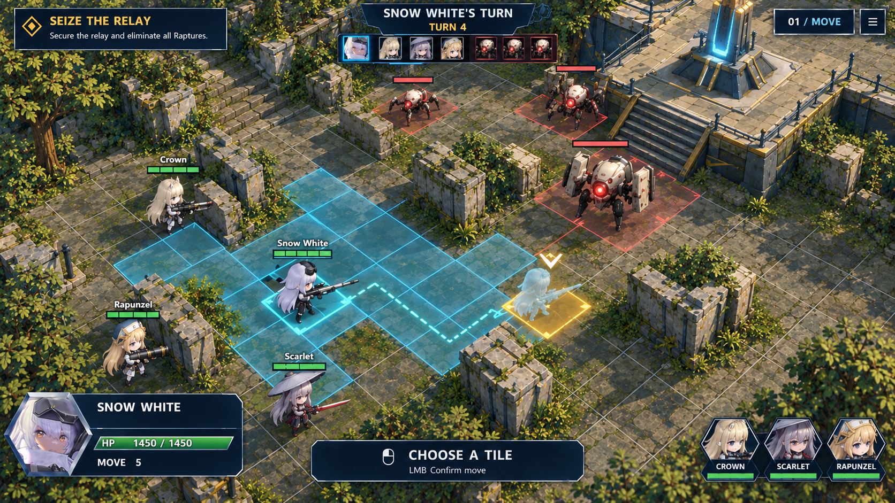
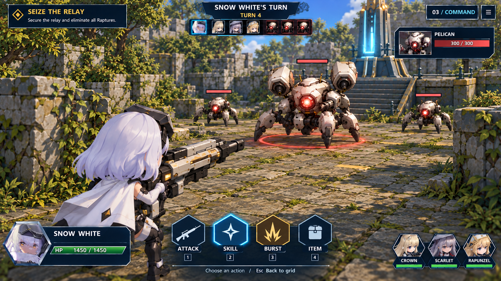
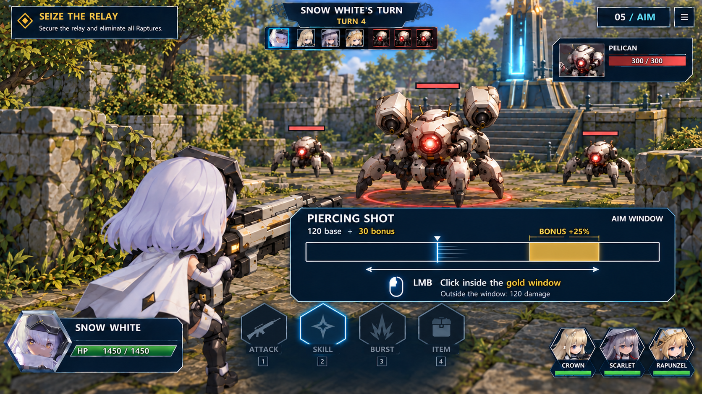
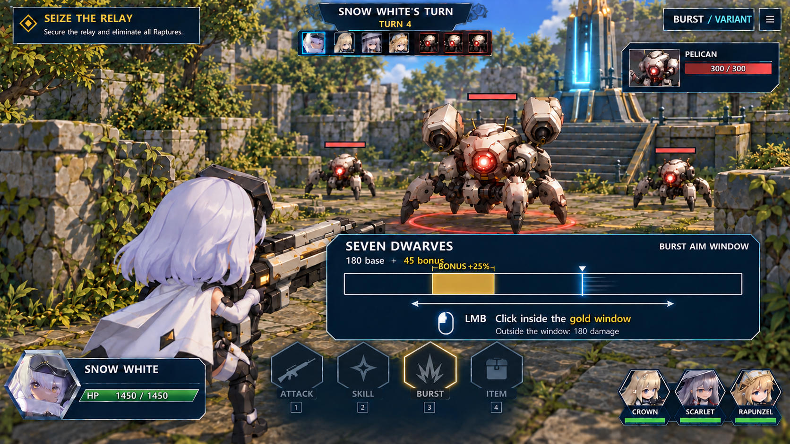

# Grid tactics + focused character turns

Seven screenshot-based mockups exploring the user's proposed hybrid. Open [the gallery](index.html) to browse the six-step turn and one alternative Burst example.

The command menu is exactly **Attack, Skill, Burst, Item**. There is no Defend command. The attack interaction uses one line moving back and forth across a horizontal bar; click while the line is inside the highlighted interval for extra damage. Each offensive action can define its own interval.

**Latest user feedback:** prefer the earlier JRPG layout's compact vertical command menu on the left over this study's large bottom buttons. Keep Attack, Skill, Burst and Item, plus the aim-window mechanic. The images below document the initial study and have not been regenerated. Other genres are still being explored.

| Grid positioning | Character command view |
| --- | --- |
|  |  |

| Skill timing | Burst timing alternative |
| --- | --- |
|  |  |

## The visual sequence

1. [Move on the grid](G01-grid-movement.png) — Preview a destination and its path. Position and cover remain tactical decisions.
2. [Choose a target](G02-grid-target.png) — Confirm the move, then select the Pelican. The camera changes only after target confirmation.
3. [Choose a command](G03-character-commands.png) — Focus behind Snow White, with Attack, Skill, Burst and Item in the existing bottom HUD style.
4. [Preview the skill](G04-skill-preview.png) — Choose Piercing Shot and see its base damage, bonus and aim-window preview before confirming.
5. [Time the click](G05-aim-window.png) — The white line travels back and forth. Click while it is inside the gold section for the bonus.
6. [Resolve the attack](G06-bonus-result.png) — Successful timing adds 30 to the 120 base damage. The target goes from 300 HP to 150 HP.
7. [Compare a Burst window](G07-burst-window-variant.png) — An alternative action, not the next step: Seven Dwarves has a narrower window farther left.

After the result, the intended flow returns to the grid for the next character. The Burst image is an alternative action from the same starting state, **not** a second action after the pictured result.

## Confirmed direction for these mockups

- Movement and initial target selection happen on the grid.
- The camera then focuses behind the acting character for action selection.
- The four commands are Attack, Skill, Burst and Item.
- The timing cursor moves back and forth; a highlighted bar section defines success.
- The section can change with the selected skill.
- Successful timing grants extra damage.
- No defensive reactive dodging or parrying.
- Keep the current flat navy, cyan and gold UI and hex portraits. Latest preference: use the earlier JRPG vertical command menu on the left instead of the pictured bottom action dock.
- Continue exploring through visuals before implementing a genre conversion.

## Proposed details, still open to tuning

These choices make the mockups concrete; they are not final balance decisions.

- Clicking outside the window deals the attack's normal base damage. No attack cancellation.
- Piercing Shot: 120 base + 30 bonus = 150; one charge spent from two available.
- Seven Dwarves alternative: 180 base + 45 bonus = 225.
- The example bonus is +25%. The skill window is toward the right; the Burst window is narrower and farther left.
- Piercing Shot and Armor Break are illustrative skill choices, not an assertion that these turn-based skills already exist in the game.
- Keep the same cursor speed initially; vary window width and position by action. Decide time limits, number of passes and accessibility settings through a small interaction test.
- Inputs confirming a skill must be released before the timing click is armed, so a double-click cannot accidentally resolve the attack.
- One timed click should produce one resolution and one resource spend. Canceling before the timing phase should not spend the charge.
- For ally-targeted skills/items or ground-targeted abilities, allow retargeting from the command view and a return to the grid when needed. The initial enemy target must not lock out utility choices.
- Range, cover and line of sight should remain authoritative from the grid. Camera movement does not relocate units.
- Keep camera movement and attack effects short. One modest muzzle flash / impact is enough for the pictured shot.
- Item behavior, area effects, Burst meter rules and non-damaging action timing are not decided by this study.

## What this demonstrates

The tactical layer provides positioning and target choice. The closer camera gives each character a focused turn and room for their personality, while the aim window adds a small attack-side interaction. The same window widget can support multiple skills without requiring bespoke defensive reaction animations.

The main pacing risk is asking for too many confirmations per action. Review the skill preview and timing start together before implementation; a selected skill may be confirmed with a single click, followed by one distinct timing click. Do not require the player to reselect the same target.

## References and provenance

Actual game screenshots:

- [Current flat HUD](references/hud.png)
- [Current painted battlefield](references/world.webp)
- [Snow White in the current game](references/hero.png)

Earlier generated concepts, used for composition only:

- [Grid tactics study](references/grid.png)
- [Behind-character JRPG study](references/jrpg.png)

The old concepts contain superseded menu choices. Only the new seven images and requirements above describe this proposal.

All seven images were generated with the **built-in imagegen tool**, inspected inline, and copied unchanged into this directory at native **1672 × 941** resolution. They are conceptual images, not screenshots of implemented gameplay. AI-generated geometry, enemy equipment and exact window proportions can vary between views; the intended implementation uses the actual map and assets consistently.

[manifest.json](manifest.json) contains the complete prompt set and portable reference paths. [verification.json](verification.json) records image sizes, hashes and file/link checks. The gallery runs directly from this directory without a build or external dependencies. Interactive browser review was unavailable in this session; browser behavior is not claimed as verified.

No gameplay source or assets were changed. The archived MOBA baseline remains preserved. The other genre options remain available.
