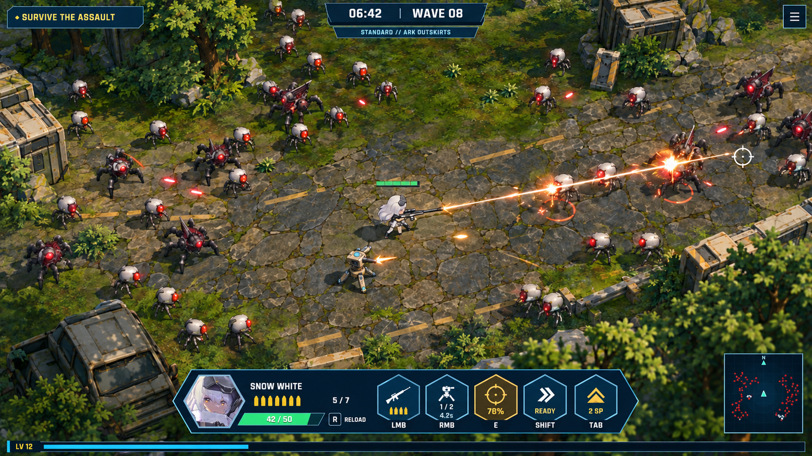
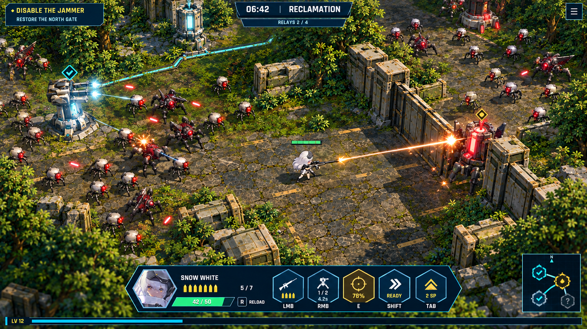
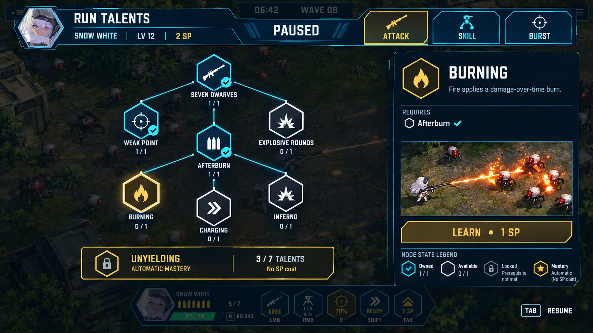
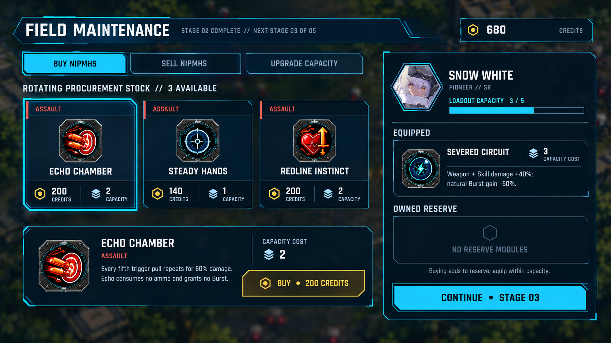

# Survivors of Victory 3D — 15 visual directions

2026-10-24 · Visual planning, no gameplay changes.

Open **index.html** locally for filters, full-size viewing, an A/B slider and a shortlist.
On GitHub, use the image links below. [Read the design plan](../../SURVIVORS_VISUAL_PLAN.md).

Suggested starting combination: **H02 centered HUD + T01 hex tree + M01 Reclamation**.
These are options to review, not an implementation commitment. The four new modes are alternatives.

| Combat dock | Reclamation |
| --- | --- |
|  |  |
| Hex talent tree | Field maintenance |
|  |  |

## Combat HUD

| ID | Image | What to assess |
| --- | --- | --- |
| H01 | [Familiar bottom HUD](H01-faithful-bottom-hud.png) | Keep the familiar portrait at lower left and large combat hexes in the middle. |
| H02 | [Compact centered command dock](H02-compact-command-dock.png) | Bring the portrait, health, ammo and action states into one centered dock. |
| H03 | [Late-run pressure and melee readability](H03-scarlet-horde-readability.png) | Check the HUD against late-run pressure and a melee character. |

## Mode concepts

| ID | Image | What to assess |
| --- | --- | --- |
| M01 | [Reclamation — change the battlefield](M01-reclamation.png) | Clear jammers, restore relays and turn captured defenses into support. |
| M02 | [Ark Convoy — a mobile home base](M02-ark-convoy.png) | Escort a mobile home base through route choices and blocked streets. |
| M03 | [Breach Hunt — dismantle a moving threat](M03-breach-hunt.png) | Fight the horde while destroying specific boss components to remove attacks. |
| M04 | [Surface Salvage — choose when to leave](M04-surface-salvage.png) | Choose between a safe exit and more carried salvage as the storm approaches. |

## Talent trees

| ID | Image | What to assess |
| --- | --- | --- |
| T01 | [Hex tree — compact nodes, clear detail pane](T01-hex-attack-tree.png) | Seven normal hex nodes, accurate prerequisite links and a separate automatic mastery. |
| T02 | [Card tree — readable effects without hovering](T02-card-attack-tree-v2.png) | The same Attack build shown as cards with short effect text. |
| T03 | [Quick spend drawer — all choices remain accessible](T03-quick-spend-drawer.png) | A paused drawer for quickly spending a point on available talents. |
| T04 | [Skill tree — turret build and mastery gate](T04-skill-turret-tree.png) | The hex layout applied to Snow White's authored turret Skill tree. |
| T05 | [Scarlet Burst — explain reward and HP cost](T05-scarlet-burst-tree-v2.png) | Scarlet's authored Burst tree with the healing payoff and HP cost shown together. |
| T06 | [Build overview — compare all three categories](T06-three-category-build-overview-v2.png) | See all three categories' owned nodes and mastery progress in one view. |

## Operation flow

| ID | Image | What to assess |
| --- | --- | --- |
| F01 | [Operation routing — deliberate stage choices](F01-operation-route-selection.png) | Optional route choice inside the existing five-stage operation. |
| F02 | [Field maintenance — existing NIPMH choices in new UI](F02-field-maintenance.png) | Present existing NIPMH buying, reserves and weighted capacity in the new dark UI. |

## Reference and generation record

The `references/` folder contains the actual 2D/3D screenshots used. The manifest records
every selected prompt, input, revision, file hash and native dimensions. The built-in
imagegen tool returned 1672 × 941 images despite the 1920 × 1080 request; no resampling
was applied. Previous corrected variants are in `iterations/` and are not the selected designs.

Illustrative art and small UI glyphs are not final implementation specifications.
Source-authored talent mechanics govern the design. The full plan explains reuse,
new work, tradeoffs and remaining decisions. The MOBA archive is unchanged.
